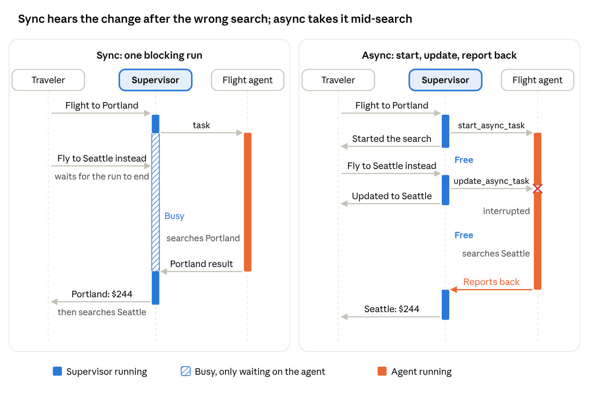

# Async Subagents: Minimal Example

The smallest working example of [Deep Agents async subagents](https://www.langchain.com/blog/agents-are-going-async). A supervisor starts a flight search in the background, replies right away, and takes "make it Seattle" while the search is still running.

## The feature

A normal agent handles one request at a time. If a step is slow, you wait for it, and anything you say meanwhile waits too.

**Async subagents** split the work. A **supervisor** talks to you. Slow work goes to **subagents**, each running in the background on its own thread. The supervisor starts a subagent, replies at once, and stays free. When the subagent finishes, it reports back on its own.



- **Sync (left):** you ask for Portland, then say "fly to Seattle instead." The supervisor is busy waiting on the flight agent, so your change waits until the Portland search is done. Then it searches again.
- **Async (right):** the supervisor starts the search with `start_async_task` and replies. Your change goes out with `update_async_task`, which interrupts the Portland search and restarts it for Seattle. When the search finishes, the flight agent reports back and the supervisor answers.

## How this repo implements it

| Part of the feature | Where it is in this code |
|---|---|
| A subagent that runs in the background | `flight_agent` in `agents.py`, listed in the supervisor's `subagents` as an `AsyncSubAgent` |
| Start a task and reply at once | `start_async_task`, a tool the supervisor gets automatically from the `AsyncSubAgent` spec |
| Change a running task | `update_async_task`. The default `update_strategy="interrupt"` stops the Portland run and restarts it with the new city, on the same thread |
| Results come back on their own | `flight_agent` is built with `create_deep_agent`, which reports back to the supervisor when its run ends. No polling |
| Supervisor and subagent on one server | `langgraph.json` registers both graphs, so the supervisor calls the subagent in-process |
| A user who changes their mind | `run.py` asks for Portland, then switches to Seattle while the search is running |

## Files

| File | What it does |
|---|---|
| [`agents.py`](agents.py) | Defines both agents. `flight_agent` has one tool, `search_flights`. `supervisor` lists `flight_agent` as an `AsyncSubAgent` and its prompt says when to start and update the task. |
| [`langgraph.json`](langgraph.json) | Registers `supervisor` and `flight_agent` as graphs on the local Agent Server. `graph_id="flight_agent"` in `agents.py` points here. |
| [`run.py`](run.py) | Plays the user. Asks for Portland, switches to Seattle, then waits for the result to arrive. |
| [`pyproject.toml`](pyproject.toml) | Dependencies: `deepagents`, `langchain-ollama`, the LangGraph CLI and SDK. |
| [`sync-vs-async.png`](sync-vs-async.png) | The diagram above. |

## Run it

Requires Python 3.12+, [uv](https://docs.astral.sh/uv/) and [Ollama](https://ollama.com) with `qwen3-coder-next`. Runs locally, no API cost.

```bash
uv sync
uv run langgraph dev --n-jobs-per-worker 10   # terminal 1: the local Agent Server
uv run python run.py                          # terminal 2
```

Output from a real run:

```
you: Find me a flight to Portland.
agent: I've started searching for the cheapest flight to Portland. I'll let you know as soon as I find the results.

you: Actually, make it Seattle.
agent: I've updated the destination to Seattle and am now searching for the cheapest flight.

agent: The cheapest flight to Seattle is $244, nonstop. Let me know if you'd like to proceed or need more details!
```

Timings from the server's records for that run:

| Time | What happened |
|---|---|
| 5s | Supervisor replies; the search is still running |
| 6s | "Make it Seattle" sent |
| 10s | Portland run `interrupted`; Seattle run starts on the same thread |
| 11s | Supervisor confirms the change |
| 43s | Seattle search finishes and wakes the supervisor |
| 44s | Supervisor gives the result |

You can also open LangGraph Studio from the URL `langgraph dev` prints, pick the `supervisor` graph, and chat with it.

## Notes

- **`asyncio.sleep(30)` in `search_flights` fakes a slow API.** Without it the search finishes in a second or two, before you can change the city. In real code, remove it; the real API call is the slow part.
- **`--n-jobs-per-worker 10`:** every active run (supervisor, subagent, each report back) takes a worker slot. With too few, tasks queue.
- **Beta:** `update_strategy` and the report-back notifications need `deepagents` 0.7.30 or later and may change.
